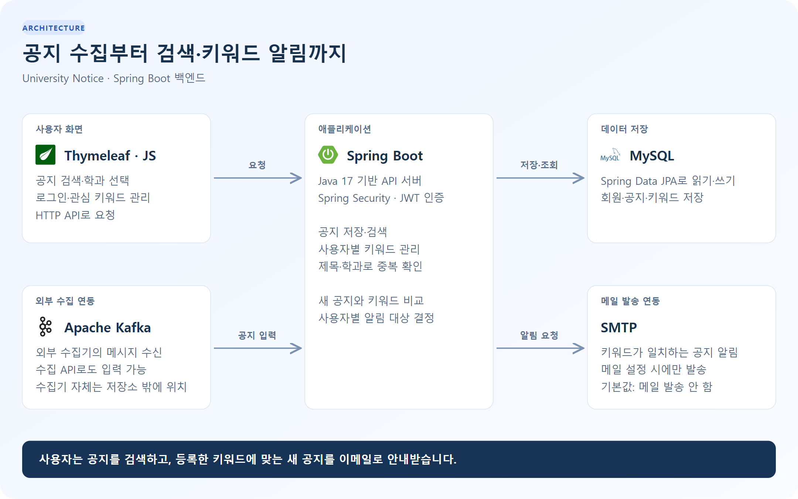
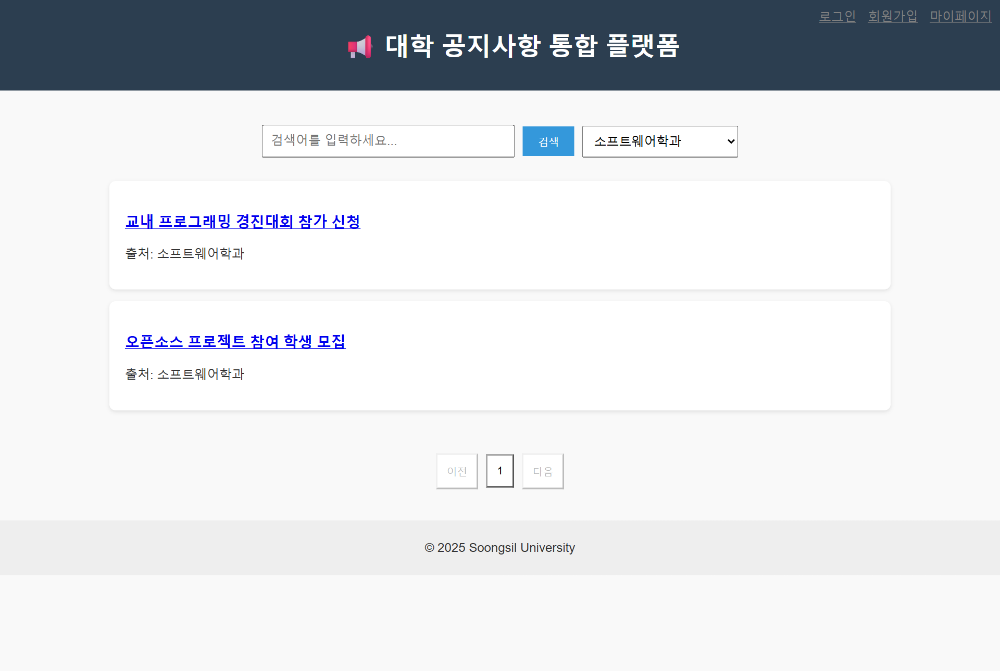
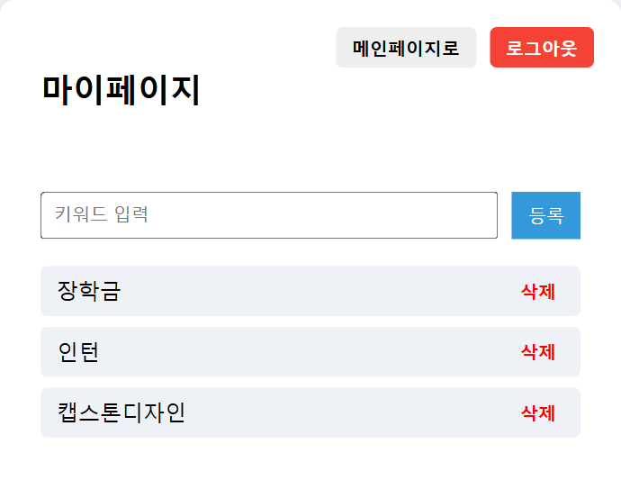

# 대학 공지사항 알림 시스템

[](https://github.com/leedidc/univ_notice-BE/actions/workflows/check.yml)

## 프로그램 용도

여러 학과의 공지를 한곳에서 검색하고, 관심 키워드에 맞는 새 공지를 이메일로 안내하는 웹 애플리케이션입니다. 사용자는 학과별 공지를 조회하고 마이페이지에서 알림 키워드를 관리합니다.

이 저장소에는 백엔드와 웹 화면이 포함되어 있습니다. 공지를 가져오는 외부 수집기는 별도로 연결합니다.

## 기술 스택

| 구분           | 사용 기술                              |
| -------------- | -------------------------------------- |
| 서버           | Java 17, Spring Boot 3.4               |
| 인증           | Spring Security, JWT                   |
| 데이터 저장    | Spring Data JPA, MySQL                 |
| 수집·알림 연동 | Apache Kafka, Spring Mail, SMTP        |
| 화면           | Thymeleaf, HTML, CSS, JavaScript       |
| 빌드·테스트    | Gradle 8.13, JUnit, H2, GitHub Actions |

## 아키텍처

[](docs/images/architecture.svg)

외부 수집기가 Kafka 또는 수집 API로 공지를 전달하면 서버가 중복 여부를 확인하고 저장합니다. 사용자가 속한 학과의 새 공지에서 관심 키워드가 발견되면 이메일로 안내합니다. 키워드는 공지 제목·학과명·링크를 대상으로 비교하며, 메일과 Kafka 연동은 설정한 경우에만 동작합니다.

[구성도 크게 보기](docs/images/architecture.svg)

## 실행 화면

예제 계정과 공지를 넣어 실행한 화면입니다. 촬영에는 임시 H2 데이터베이스를 사용했으며 실제 메일은 발송하지 않았습니다.

### 공지 검색

검색어와 학과를 선택해 필요한 공지를 찾습니다.

[](docs/images/notices-demo.png)

### 관심 키워드 관리

로그인한 사용자가 알림을 받을 키워드를 등록하거나 삭제합니다.

<a href="docs/images/keywords-demo.png"></a>

## 실행 방법

JDK 17과 MySQL을 준비합니다. 아래 명령은 Windows PowerShell 기준입니다.

**1. MySQL에 빈 데이터베이스를 만듭니다.**

```sql
CREATE DATABASE univ_notice CHARACTER SET utf8mb4;
```

**2. 저장소 폴더에서 접속 정보와 서명 키를 설정합니다.**

```powershell
$env:DB_USERNAME = Read-Host "MySQL 사용자"
$env:DB_PASSWORD = [System.Net.NetworkCredential]::new("", (Read-Host "MySQL 비밀번호" -AsSecureString)).Password
$env:JWT_SECRET = [guid]::NewGuid().ToString("N") + [guid]::NewGuid().ToString("N")
$env:DB_DDL_AUTO = "update"
```

기본 DB 주소는 `jdbc:mysql://localhost:3306/univ_notice`입니다. 다른 주소를 사용하려면 `DB_URL`을 설정합니다. `DB_DDL_AUTO=update`는 새 개발 DB의 테이블을 만들 때 사용하고, 이후에는 기본값인 `validate`로 돌려놓습니다. 환경변수 목록은 [.env.example](.env.example)에 있으며, `.env` 파일을 자동으로 읽지는 않습니다.

**3. 서버를 실행하고 접속합니다.**

```powershell
.\gradlew.bat bootRun
```

<http://localhost:8080>에서 회원가입 후 로그인합니다. Linux/macOS에서는 같은 환경변수를 설정하고 `./gradlew bootRun`을 실행합니다.

<details>
<summary>공지 수집·메일 연동과 테스트</summary>

- **수집 API:** `INGESTION_KEY`를 설정한 뒤 `POST /notice`의 `X-Ingestion-Key` 헤더에 같은 값을 전달합니다. 본문에는 `dept`, `title`, `link`, `postedAt`을 넣습니다.
- **Kafka:** `KAFKA_ENABLED=true`와 `KAFKA_BOOTSTRAP_SERVERS`를 설정합니다. 기본 토픽은 `notice`이며 메시지 필드는 수집 API와 같습니다.
- **메일:** SMTP 접속 정보와 `MAIL_FROM`, `MAIL_ENABLED=true`를 설정합니다. 기본값에서는 실제 메일을 발송하지 않습니다.
- **테스트:** `./gradlew test bootJar`를 실행합니다. 테스트는 H2와 모의 메일 발송기를 사용하므로 운영 DB·SMTP·Kafka가 필요하지 않습니다.

</details>

## 기능

| 기능        | 설명                                                  |
| ----------- | ----------------------------------------------------- |
| 공지 검색   | 제목·학과별 검색과 페이지 이동                        |
| 회원 관리   | 회원가입, 로그인, 비밀번호 변경, 회원 탈퇴            |
| 키워드 관리 | 사용자별 관심 키워드 등록·삭제                        |
| 공지 수집   | Kafka 메시지 또는 수집 API로 공지 입력                |
| 중복 처리   | 제목과 학과가 같은 공지의 중복 저장 방지              |
| 이메일 알림 | 새 공지와 키워드가 일치하면 사용자별 한 번씩 안내     |
| 접근 제어   | 사용자 API에 JWT 인증 적용, 수집 API는 별도 키로 보호 |

비밀번호를 변경해도 이미 발급된 JWT는 만료 시점까지 최대 1시간 동안 유효합니다.

[원 프로젝트](https://github.com/wib2/univ_notice-BE) · [이미지 출처](docs/images/ATTRIBUTION.md)
