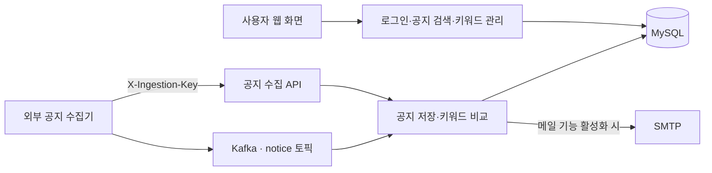

# 대학 공지사항 · Backend

학과별 공지를 모아 검색하고, 사용자가 등록한 키워드에 맞는 공지를 이메일로 알리는 웹 애플리케이션입니다.

## 기술 스택

Java 17 · Spring Boot 3.4 · Spring Security/JWT · JPA/MySQL · Kafka · Thymeleaf · Gradle 8.13

## 동작 원리



수집기는 이 저장소에 포함되지 않습니다. Kafka 메시지와 수집 API의 본문은 `dept`, `title`, `link`, `postedAt` 필드를 사용합니다. 동일 제목과 학과의 공지는 중복 저장하지 않습니다. 날짜는 `yyyy-MM-dd`, `yyyy.MM.dd`, `yyyy. MM. dd`와 해당 날짜 뒤에 `THH:mm:ss`가 붙는 형식을 지원합니다.

## 실행

1. JDK 17과 MySQL을 준비하고 빈 `univ_notice` 데이터베이스를 만듭니다.
2. `.env.example`을 참고해 **실행 프로세스의 환경변수**를 설정합니다. `.env` 파일은 자동으로 읽지 않습니다. 필수값은 `DB_USERNAME`, `DB_PASSWORD`, 무작위 32바이트 이상의 `JWT_SECRET`입니다.
3. 새 개발 DB의 테이블을 생성할 때만 `DB_DDL_AUTO=update`를 설정합니다. 기본값은 `validate`입니다.
4. `./gradlew bootRun`으로 실행합니다. Windows에서는 `gradlew.bat bootRun`을 사용합니다. 기본 주소는 `http://localhost:8080`입니다.

Kafka 수집은 `KAFKA_ENABLED=true`와 접속 주소를 설정해야 시작됩니다. 직접 수집 API를 쓰려면 `INGESTION_KEY`를 설정하고 `POST /notice` 요청의 `X-Ingestion-Key` 헤더에 같은 값을 전달합니다.

메일은 기본적으로 꺼져 있습니다. 사용하려면 SMTP 환경변수와 `MAIL_FROM`, `MAIL_ENABLED=true`를 설정합니다. 테스트는 H2와 모의 메일 발송기를 사용하며 실제 이메일을 보내지 않습니다.

## 검증

```sh
./gradlew test bootJar
```

테스트에는 운영 DB·SMTP·Kafka가 필요하지 않습니다. GitHub Actions에서도 같은 빌드와 테스트를 실행합니다. 비밀번호 변경 후 이미 발급한 JWT는 최대 1시간의 만료 시점까지 유효합니다.

원본: 사용자가 제공한 `univ_notice-BE-main.zip` ([원 프로젝트](https://github.com/wib2/univ_notice-BE)). 원본의 하드코딩된 접속 정보는 제거했으며 기존 사용자·공지 데이터는 포함하지 않습니다.
